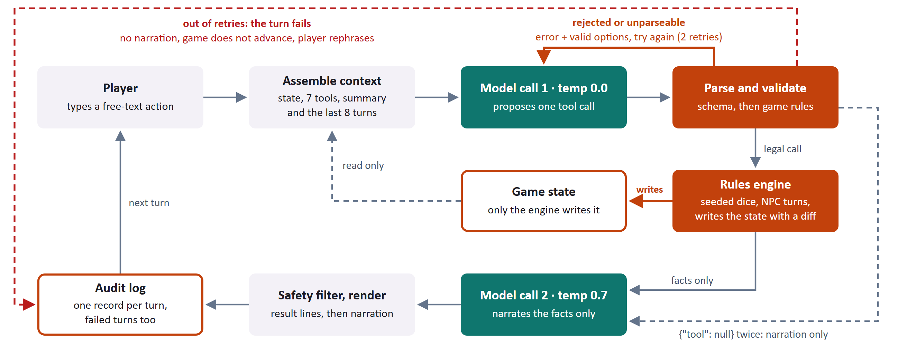

# Architecture diagram: the turn loop

WBS 11.8 · Owner: SS · Drawn 2026-11-21 · CLAUDE.md wins on any conflict.

The loop-corrected architecture diagram: one condition D turn, drawn as a loop with its two model calls. Done when: "Shows two model calls per turn" (TASK_CHECKLIST.md, 11.8). It is Figure 3.1 of the report (`docs/report/03_system_design.md` §3.1) and slide 5 of the defence deck (`docs/defence_deck.md` §4).



## 1. What it shows

Every box and edge is taken from CLAUDE.md. Nothing in it is new.

| On the diagram | Source |
|---|---|
| Two model calls: call 1 at temperature 0.0 proposes one tool call, call 2 at 0.7 narrates | §2.2, §7 |
| Context: the state, the seven tools, the rolling summary and the last K = 8 turns | §8, §2.2 |
| Parse, then validate: schema first, then the game rules | §6.2, `docs/tool_contract.md` §1 |
| Rejected or unparseable: the error and `valid_options` go back to call 1, 2 retries at most | §6.2, §7.1 |
| Out of retries: no narration call, the game does not advance, the turn is still logged | §7.1 |
| `{"tool": null}` twice: a narration-only turn, which skips the engine | §7.1 |
| The engine is the only writer of the state; every write has a diff; NPC turns run in the engine | §1.1 invariants 1 and 2, §4.8 |
| The model reads the state only in its prompt (read only) | §1, §8 |
| Call 2 receives `narration_facts`, not the state | §9.1, §15 item 12 |
| Safety filter, then the result lines and the narration | §7, §15 items 40 to 42 |
| One audit-log record per turn, failed turns included; then the next turn | §7.1, §11 |

Colours follow the deck: teal is the model, orange the engine, and a white box with an orange border is data the engine owns. Grey boxes are the player and the orchestration code. Dashed edges are the read-only path, the no-tool path and the failure path.

## 2. What the draft got wrong

The draft on slide 5 (WBS 11.7) drew the two model calls but differed from §7 and §7.1 in four places, which this diagram corrects. The text version of Figure 3.1 (WBS 11.2) had the failure and no-tool paths, but not the state (3).

1. **The failed turn had no path.** The draft said "turn fails" only in a label. Here it is an edge from validation straight to the audit log, past both the engine and call 2, so it is visible that a failed turn is logged but never narrated.
2. **The no-tool path was missing on the slide.** A second `{"tool": null}` ends the turn narration-only, with no engine call.
3. **The state was not drawn.** The diagram now shows the one rule of slide 4: the engine writes the state, the model only reads it through its prompt, and call 2 does not read it at all.
4. **The audit log was inside the engine box.** The log gets one record per turn at the end of the turn, failed turns included, and the loop closes through it.

## 3. Files

The SVG is the source, written by hand in the deck's colours and fonts (Calibri). The PNG was rendered from it at 3× (2622 × 1002 px) with headless Microsoft Edge on Windows:

```
msedge --headless=new --disable-gpu --hide-scrollbars --force-device-scale-factor=3 --window-size=874,334 --screenshot=fig_turn_loop.png file:///<repo>/docs/report/figures/fig_turn_loop.svg
```

Slide 5 holds the SVG itself, inserted in PowerPoint, so the slide and the report draw the same file. Another browser or a machine without Calibri may render slightly different PNG bytes from the same SVG.

| File | sha256 |
|---|---|
| `docs/report/figures/fig_turn_loop.svg` | `6930355a11308f3f0e5c0cae2dea0b109924719b819431577891fb08d186e5ef` |
| `docs/report/figures/fig_turn_loop.png` | `0119bbbb6c5e32967a5079d19d0b9dd484b2a9ed6c435ba10dc0b159d6ce280c` |

To change the diagram, edit the SVG, render the PNG again, replace the picture on slide 5, and update the hashes here and in `docs/defence_deck.md` §6.
