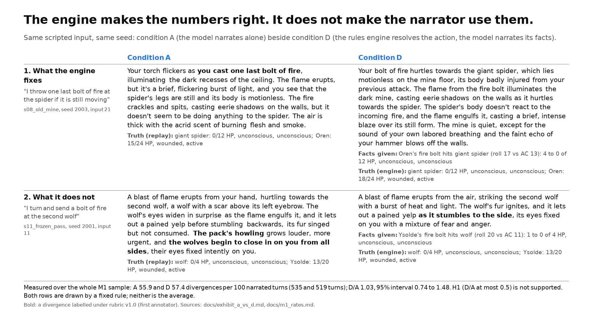

# Side-by-side exhibit: condition A versus condition D

WBS 10.8 · Owner: SS · Drawn 2026-11-19 · CLAUDE.md wins on any conflict.

The defence slide that sets condition A's narration beside condition D's at the same scripted input and seed. Done when: "The single strongest defence slide" (TASK_CHECKLIST.md, 10.8). For the deck (11.7) and the report's Results (`docs/report_outline.md` §5.3).

## 1. How the pairs were chosen

Fixed in `docs/decisions.md` (2026-11-19, "A-versus-D exhibit, fixed before the draw") and committed (0dc03b0) before the command was run on the labels.

| Item | Rule |
|---|---|
| Pair | One scripted input at one seed of the M1 sample, with A's and D's narrated turns. Combat only: the scenario's `expected_call` is `attack` or `cast_spell`, and D executed the same tool. |
| Row 1, what the engine fixes | A's narration has a `CONTRADICT` or `RULE` label; D's has no label at all. |
| Row 2, what it does not | D's narration has a `CONTRADICT` label, though its narrator was given the facts. |
| Draw | Within a row, the qualifying pairs in sha256 order of `10.8-v1/<row>/<scenario>/<seed>/<input>`, the first taken; the two rows on different inputs. |
| Each side | The narration with its labelled divergences in bold (SD's 9.5 labels, rubric v1.0) and the truth it is scored against for the combatants the call names: A's replayed ground truth; D's facts and logged state. |
| On the slide | The 10.1 result: A's and D's M1 rates and D/A with its interval. H1 is not supported, and the slide says so. |
| Command | `python -m adm.eval.exhibit --checksums experiments/main_grid.sha256 --doc docs/exhibit_a_vs_d.md` (needs the `analysis` extra) |

**Why two rows.** A slide with only a pair where D wins would claim what the data do not: D/A is 1.03 (0.74 to 1.48, `docs/m1_rates.md`). The two rows show what the engine guarantees, that the mechanics come from dice and rules, and what it does not, that the narrator uses them. That is what the results say.

## 2. The pairs

<!-- results:start -->
Measured over the whole M1 sample: A 55.9 and D 57.4 divergences per 100 narrated turns (535 and 519 turns); D/A 1.03, 95% interval 0.74 to 1.48. H1 (D/A at most 0.5) is not supported. Both rows are drawn by a fixed rule; neither is the average.

| Row | Rule | Pair | Drawn from |
|---|---|---|---|
| 1. What the engine fixes | A has a CONTRADICT or RULE label, D has none | `s08_old_mine`, seed 2003, input 21 | 14 pairs |
| 2. What it does not | D has a CONTRADICT label, though it was given the facts | `s11_frozen_pass`, seed 2001, input 11 | 31 pairs |

### Row 1. What the engine fixes

**Player** (`s08_old_mine`, seed 2003, scripted input 21): "I throw one last bolt of fire at the spider if it is still moving"

#### Condition A (`A_s08_old_mine_2003`)

> Your torch flickers as **you cast one last bolt of fire**, illuminating the dark recesses of the ceiling. The flame erupts, but it's a brief, flickering burst of light, and you see that the spider's legs are still and its body is motionless. The fire crackles and spits, casting eerie shadows on the walls, but it doesn't seem to be doing anything to the spider. The air is thick with the acrid scent of burning flesh and smoke.

1. `RULE` "you cast one last bolt of fire"

Truth it is scored against (replayed ground truth): giant spider: 0/12 HP, unconscious, unconscious; Oren: 15/24 HP, wounded, active

#### Condition D (`D_s08_old_mine_2003`)

Tool-call attempts:

1. `{"tool": "cast_spell", "arguments": {"caster_id": "pc_oren", "spell_id": "spell_fire_bolt", "target_id": "npc_giant_spider"}} -> ok`

Facts given to the narrator:

- Oren's fire bolt hits giant spider (roll 17 vs AC 13): 4 to 0 of 12 HP, unconscious, unconscious

> Your bolt of fire hurtles towards the giant spider, which lies motionless on the mine floor, its body badly injured from your previous attack. The flame from the fire bolt illuminates the dark mine, casting eerie shadows on the walls as it hurtles towards the spider. The spider's body doesn't react to the incoming fire, and the flame engulfs it, casting a brief, intense blaze over its still form. The mine is quiet, except for the sound of your own labored breathing and the faint echo of your hammer blows off the walls.

No divergence labelled.

Truth it is scored against (logged state): giant spider: 0/12 HP, unconscious, unconscious; Oren: 18/24 HP, wounded, active

### Row 2. What it does not

**Player** (`s11_frozen_pass`, seed 2001, scripted input 11): "I turn and send a bolt of fire at the second wolf"

#### Condition A (`A_s11_frozen_pass_2001`)

> A blast of flame erupts from your hand, hurtling towards the second wolf, a wolf with a scar above its left eyebrow. The wolf's eyes widen in surprise as the flame engulfs it, and it lets out a pained yelp before stumbling backwards, its fur singed but not consumed. **The pack's howling** grows louder, more urgent, and **the wolves begin to close in on you from all sides**, their eyes fixed intently on you.

1. `PHANTOM` "The pack's howling"
2. `CONTRADICT` "the wolves begin to close in on you from all sides"

Truth it is scored against (replayed ground truth): wolf: 0/4 HP, unconscious, unconscious; Ysolde: 13/20 HP, wounded, active

#### Condition D (`D_s11_frozen_pass_2001`)

Tool-call attempts:

1. `{"tool": "cast_spell", "arguments": {"caster_id": "pc_ysolde", "spell_id": "spell_fire_bolt", "target_id": "npc_wolf_02"}} -> ok`

Facts given to the narrator:

- Ysolde's fire bolt hits wolf (roll 20 vs AC 11): 1 to 0 of 4 HP, unconscious, unconscious

> A blast of flame erupts from the air, striking the second wolf with a burst of heat and light. The wolf's fur ignites, and it lets out a pained yelp **as it stumbles to the side**, its eyes fixed on you with a mixture of fear and anger.

1. `CONTRADICT` "as it stumbles to the side"

Truth it is scored against (logged state): wolf: 0/4 HP, unconscious, unconscious; Ysolde: 13/20 HP, wounded, active

### Files

| File | sha256 |
|---|---|
| `docs/report/figures/fig_a_vs_d.png` | `bb4a86682a7b3b92e9d6fbe5897b49c61c0080fcfe7b1d5e243b5a072ff39b48` |
| `docs/report/figures/fig_a_vs_d.svg` | `58b4100eb8ae63a83cda7c63384f84cee50685404866f95d542cd9ef677f4689` |
<!-- results:end -->

## 3. Reading

Read after the draw, with the replayed ground truth checked around both inputs.

### 3.1 The two rows

- **Row 1, what the engine fixes.** In A's ground truth the spider fell at input 20 and the fight ended. The scripted bolt at input 21 is one the rules refuse, and the replay rejects it. A narrates the cast anyway, a rule break with nothing to stop it. In D the engine resolved the bolt with dice (in D's own run the spider was still at 4 of 12) and handed over "hits, 4 to 0, unconscious". D's narration describes a still body that does not react, which agrees with the facts. **Caveat, from this same D run:** two inputs earlier, D's narrator had already called the spider dead at 4 of 12 (`docs/failure_catalogue.md`, entry 3). At input 21 the facts caught up with the story; the narrator did not get better.
- **Row 2, what it does not.** The bolt drops the second wolf in both conditions' truth: 1 to 0, unconscious, fight over. D's narrator was handed exactly that, and has the wolf stumble aside with "its eyes fixed on you". A has the pack closing in after the fight ended, and invents a howling pack. The engine's state is right in D. The narration is wrong in both.

### 3.2 What the slide says

- **The engine guarantees the mechanics.** In D every action is resolved by dice and rules, and nothing illegal reaches the state: the cast A narrates in row 1 would have been refused. The M4 state audit is zero by construction (`docs/m4_rule_violations.md`).
- **It does not guarantee the narration.** The narrator still contradicts facts it was handed (row 2), and an agreeing turn can follow a disagreeing one (row 1's caveat). This is the 10.1 result: D/A 1.03, interval 0.74 to 1.48. H1 is not supported, and the slide states it under the rows.
- **For scale only:** under these rules, 14 combat pairs qualify for row 1 and 31 for row 2. The two rules differ, so this is not a rate. It does say that, among combat inputs, the pattern of row 2 is not the rarer one.

### 3.3 For the deck (11.7) and the report

- Use `docs/report/figures/fig_a_vs_d.png` (or the SVG) as one slide. Read the measured line aloud; it is the answer to "so is D better?".
- Anticipated question, "Did you pick these?": the rows were fixed in the decision log and committed (0dc03b0) before the draw, and each is the first qualifying pair in hash order, from 14 and 31.
- The labels are an AI draft accepted by SD (`docs/m1_annotation.md` §3). The report says so wherever it quotes a row.
