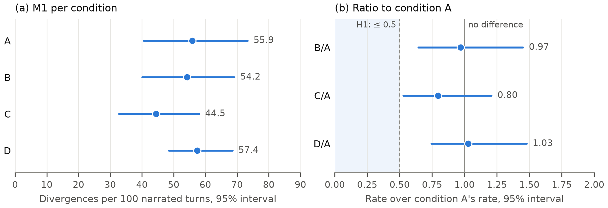
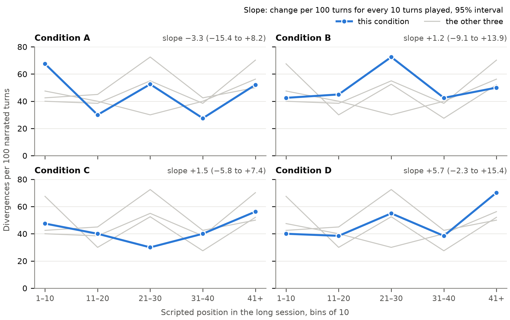
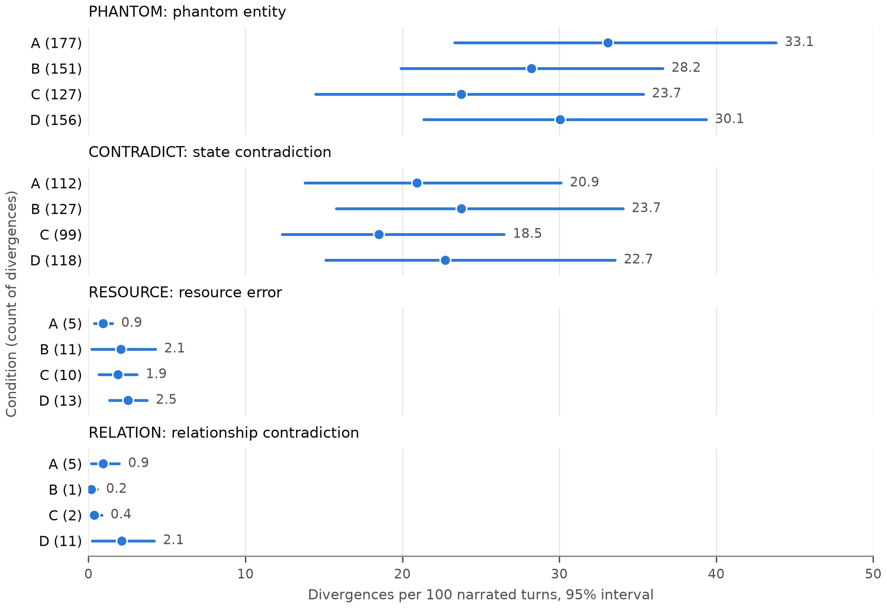

# Report figures: M1 rate, growth and taxonomy

WBS 10.6 · Owner: SS · Drawn 2026-11-19 · CLAUDE.md wins on any conflict.

The three figures of the report's Results (`docs/report_outline.md` §5): the M1 rate by condition (5.1), the growth curves (5.2) and the error taxonomy (5.3). Done when: "Three finished figures" (TASK_CHECKLIST.md, 10.6).

## 1. Definitions

Fixed in `docs/decisions.md` (2026-11-19, "Report figures") before the figures were drawn from the labels.

| Term | Definition |
|---|---|
| Data | The 10.1 and 10.2 reports, `results/m1.json` and `results/m1_growth.json`, as their commands write them (`docs/m1_rates.md` §2, `docs/m1_growth.md` §2). The two must name the same labels, annotator, manifest and checksum file, and the same bootstrap. |
| No new number | Every value drawn is one those reports hold, with the interval they give. The figures compute no statistic, so none can be chosen for how it looks. |
| Condition | Named by an axis position or a panel title, never by colour alone. One series colour; grey for context and reference lines. Four hues on one plot cannot all be told apart under colour-vision deficiency. |
| Files | PNG at 300 dpi and SVG, in `docs/report/figures/`. No date or software stamp, the bundled DejaVu Sans, a fixed SVG hash salt and LF line endings in the SVG (pinned in `.gitattributes`), so a second run with the same matplotlib writes the same bytes. |

## 2. Set-up

| Item | Value |
|---|---|
| Inputs | `results/m1.json` and `results/m1_growth.json`, regenerated on SS's machine from the checksummed logs (`--checksums experiments/main_grid.sha256`) and SD's labels (sha256 `53d74b6b…138e`, as in 10.1 and 10.2). |
| Command | `python -m adm.eval.figures --doc docs/figures.md` (needs the `analysis` extra: `pip install -e ".[analysis]"`) |
| Output | The six files in `docs/report/figures/` and the block in §3, written by the command. |
| matplotlib | 3.11.2 on Windows. Another version or platform may render slightly different bytes from the same numbers. |

## 3. Results

<!-- results:start -->
Drawn from the 10.1 and 10.2 reports of 64 runs and 2124 narrated turns, labels of SD. Intervals as computed there: 95% percentile bootstrap over whole runs, 10,000 resamples, seed 20261101.

### Inputs

sha256 with line endings as LF.

| Input | sha256 |
|---|---|
| `results/m1.json` (10.1) | `35944a49b04d511729d9c784f8b9aa900953e0c7ae17e1cb96e942729f479b04` |
| `results/m1_growth.json` (10.2) | `9d8d1d47fb9f9fcbfc4c0aa4a7e5ae10ef8dd58046651ecc03f5d3479d36fc5a` |

### Files

| Figure | Report section | File | sha256 |
|---|---|---|---|
| fig_m1_rate | 5.1 | `docs/report/figures/fig_m1_rate.png` | `729d18de36868caf93bef5b40bb9e2a78797dbb59f6623e545c123a1a8ddc40e` |
| fig_m1_rate | 5.1 | `docs/report/figures/fig_m1_rate.svg` | `9f774eff9db7ae501e3832a893f5ba105709c159f201d5dc79d631a66c9e93e8` |
| fig_m1_growth | 5.2 | `docs/report/figures/fig_m1_growth.png` | `de474946cb8b9752e85b0255d2b3a8a86d33f5e7f2ad3ac400f36139469b472a` |
| fig_m1_growth | 5.2 | `docs/report/figures/fig_m1_growth.svg` | `dcbeeace9484c85ad0faaabb9b4f1d515f95a7a0dd8c67c31f66a98a5fc24b33` |
| fig_m1_taxonomy | 5.3 | `docs/report/figures/fig_m1_taxonomy.png` | `3221873c5e20d346c05a89011e5ca85efd5ee4e43069dac82adddd9e3c2aec15` |
| fig_m1_taxonomy | 5.3 | `docs/report/figures/fig_m1_taxonomy.svg` | `93b95de8c591ad9cd57560766705bb3d668d5a6756e8b404e479c79e49303b4e` |
<!-- results:end -->

## 4. The figures

### Figure 5.1: M1 per condition (`fig_m1_rate`)

**(a)** Confirmed divergences per 100 narrated turns in each condition, pooled over its 16 runs, with the 95% run-level bootstrap interval. **(b)** The ratio of each condition's rate to condition A's, with its interval. The solid line at 1 is no difference. The dashed line at 0.5 is H1's threshold, and the shaded region is where H1's point estimate would have to fall. Every interval in (a) overlaps every other. Every ratio's interval in (b) contains 1, and none reaches 0.5: H1 is not supported (`docs/m1_rates.md` §4).

### Figure 5.2: Growth against turn index (`fig_m1_growth`)

The long-session rate per 100 narrated turns in bins of ten scripted positions, the last from 41 to the end (52 inputs), pooled over each condition's 4 long-session runs. Each panel draws one condition in blue and the other three in grey behind it. Its title gives the RQ2 slope: the change in divergences per 100 turns for every 10 turns played, with its 95% interval. No slope's interval excludes 0. The bins rise and fall together across conditions, because the script, not the session length, moves the rate (`docs/m1_growth.md` §4). The bins have no interval: 10.2 fixed them for this figure only.

### Figure 5.3: Error taxonomy (`fig_m1_taxonomy`)

Divergences per 100 narrated turns by rubric v1.0 category and condition, with 95% intervals; the count of divergences is in brackets beside each condition. All four panels share one axis, so the categories can be compared. `PHANTOM` and `CONTRADICT` hold 92% to 97% of each condition's divergences (A 289 of 299, D 274 of 298, the lowest share). `RESOURCE` and `RELATION` rest on 1 to 13 divergences each. D's profile is close to A's in both large categories. 10.7 and 10.8 give examples.

## 5. Notes, for the report

- **The `m1_growth.json` hash.** The regenerated `results/m1_growth.json` matches every number in `docs/m1_growth.md` §3, but its sha256 (§3 above, LF) is not the one recorded in `docs/m1_growth.md` (`ec9207b8…`). `results/m1.json` matches its recorded hash once line endings are LF. The cause is not known from this machine; SD to compare against their copy. The figures are unaffected, since every plotted value agrees with that doc.
- **Line endings.** On Windows the 10.1 and 10.2 commands write CRLF (`Path.write_text`), so a file's raw sha256 depends on the platform. §3 hashes the inputs with line endings as LF.
- **Labels as in 10.1.** The figures inherit the 10.1 and 10.2 limitations: an AI draft accepted unchanged by SD, one seed per scenario, and wide intervals (`docs/m1_rates.md` §5, `docs/m1_growth.md` §5).
