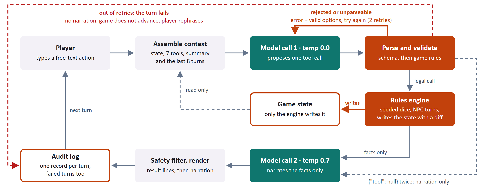

# 3. System design

<!-- WBS 11.2 · Owner: CI · Reviewer (11.6): SS · Outline: docs/report_outline.md §3 · Draft 2026-11-16 -->

This section describes the system in enough detail to rebuild it. Section 3.1 gives the architecture and the turn loop. Sections 3.2 to 3.7 describe the parts in turn: the rules engine, the state, the tool contract, the loop and its failure handling, the context the model sees, and the audit log that makes every run reproducible. Section 3.8 gives the model and the hardware. Section 3.9 maps the SPECIFY / HARNESS / VERIFY / CONTROL framing of Section 1.5 onto the four design decisions that the measurement depends on, and Section 3.10 lists where the remaining detail is kept.

## 3.1 Architecture

The system is a text-based Dungeon Master for one player character. It has three parts, and dependencies point one way: the command-line interface uses the orchestration layer, the orchestration layer uses the engine, and the evaluation code reads the engine but never the orchestration layer.

- **The rules engine** (`adm/engine/`) owns the game state and every change to it: dice, combat, spells, skill checks, inventory, quests, relationships, the non-player characters' turns, the tool validator and the audit log. It makes no network calls and never calls the model.
- **The orchestration layer** (`adm/orchestration/`) talks to the model. It assembles each prompt, parses the model's reply into a *proposed* tool call, runs the turn loop and its retry budget, keeps the rolling summary and applies the safety filter. It never assigns to a state field.
- **The evaluation code** (`adm/eval/`) scores finished runs: the automated divergence checker, the metrics and the annotation tool. It does not depend on how a run was produced.

One rule governs the design (Section 1.2): the language model never writes to game state. It may only propose tool calls, which the engine validates, executes and turns into facts that the model then narrates. The only path that changes the state is the engine's dispatch function, which validates a proposed call, executes it, checks that its recorded diff accounts for every change and that the state after it is legal, and returns either a rejection or a result. A write that fails either check is undone and raises an error.

Each player turn in condition D is a loop with two model calls, shown in Figure 3.1. The first call proposes one tool call, at temperature 0.0. The engine validates it. A rejected call goes back to the model with a structured error, and the model may try twice more. An accepted call is executed, and the second model call, at temperature 0.7, narrates the result from the engine's facts alone.

*Figure 3.1. The condition D turn loop, with two model calls per turn. Teal boxes are the model, orange boxes the engine, and outlined boxes the data the engine owns. A rejected or unparseable call goes back to model call 1 with its error, at most twice. A turn that runs out of retries fails: it has no narration call, does not advance the game, and is still logged. The model reads the state only in its prompt; the engine is its only writer. Model call 2 receives the engine's facts, not the state. Every turn, failed or not, appends one record to the audit log before the next turn starts.*

Conditions A to C use one model call per turn and no tools; they are described in Section 4.1.

## 3.2 The rules engine

The game is a deliberately small ruleset, inspired by the D&D 5e System Reference Document 5.1 (Wizards of the Coast, 2023) but not compatible with it. Everything below is implemented exactly; nothing else is.

**Characters.** Each combatant has six ability scores from 1 to 20, fixed by the scenario. The ability modifier is `floor((score − 10) / 2)`, rounded down so that a score of 7 gives −2. The proficiency bonus is a flat +2 for everyone, since the game has no levels. Armour class, weapon attack bonuses, weapon damage bonuses, the spell attack bonus and the spellcasting modifier are **stored** in the scenario, not derived from other values, which removes a class of arithmetic errors from the engine. A combatant that cannot cast has all three spell fields (`spell_attack_bonus`, `spellcasting_modifier`, `spell_slots_1`) empty. Hit points are clamped to the range 0 to `max_hp` after every write.

**Dice.** Every roll comes from one seeded random number generator per run, created from the run's seed. Notation is `XdY+Z`, with X from 1 to 20, Y one of 4, 6, 8, 10, 12, 20 and 100, and Z any integer; anything else is an error. Every roll returns its notation, the individual dice, the modifier, the total and its advantage mode, and every roll of a turn is attached to that turn's record.

**Advantage and disadvantage.** Advantage rolls two d20 and keeps the higher, disadvantage keeps the lower. If both apply they cancel and a single d20 is rolled; two sources of advantage are still just advantage. Both dice are recorded in the order rolled. The sources are a target that is dodging (disadvantage for the attacker) and a skill check that the scenario marks.

**Initiative.** When an encounter starts, each combatant rolls d20 plus its dexterity modifier. Ties are broken by the higher dexterity score, then by the alphabetically smaller identifier, so the order follows from the seed alone. The order is fixed for the encounter. An unconscious combatant keeps its place but is skipped. The round number starts at 1 and rises when the order wraps. During an encounter, a tool call whose actor is not the active combatant is rejected, whether or not it uses the action.

**Actions.** There is no map, movement or range: every combatant can reach every other. A combatant has exactly three actions, one per turn, and only these end its turn:

- *Attack.* Roll d20 plus the weapon's attack bonus against the target's armour class, with disadvantage if the target is dodging. A natural 20 on the d20, read after advantage or disadvantage has chosen the die, always hits and is a critical; a natural 1 always misses. Damage is the weapon's dice plus its damage bonus, at least 0. A critical rolls the damage dice twice and adds the bonus once, so 1d8+3 becomes 2d8+3.
- *Cast a spell.* Only two spells exist. **Fire Bolt** is a cantrip: a spell attack of d20 plus the caster's spell attack bonus, 1d10 fire damage on a hit (2d10 on a critical), the same natural-20 and natural-1 rules, and no cost. **Cure Wounds** has no attack roll and spends one level-1 slot. It heals 1d8 plus the spellcasting modifier, at least 1, up to `max_hp`. The engine records both the amount rolled and the amount applied, since they differ at the cap. It may heal an unconscious combatant, which revives it, or one already at full health, which spends the slot for nothing. It is the one spell that may be cast outside an encounter. Spell slots never recover: the game has no rests.
- *Dodge.* Attacks against the dodger have disadvantage until the start of the dodger's next turn, so the benefit lasts through everyone else's turns. A Dodge still set when an encounter ends is cleared.

Attacks and Fire Bolt may target any conscious combatant, including the attacker or an ally.

**Skill checks.** Three skills exist: strength (using the strength modifier), perception (wisdom) and stealth (dexterity). A check rolls d20 plus the modifier, plus 2 if the combatant is proficient, and succeeds if the total is at least the difficulty class (DC), which must be from 5 to 25. A check does not use the turn's action and may be made outside combat. In a scripted run the scenario fixes the DC and any advantage. When the model proposes a skill check for an input whose expected call is also a skill check, its proposed DC is validated and logged, and the check is executed with the scenario's values.

**Zero hit points.** There is no death. A combatant at 0 HP is unconscious, is skipped in the turn order and cannot act. **An unconscious combatant cannot be attacked**: an attack or Fire Bolt against one is rejected. This is a deliberate simplification of tabletop convention, which would need death rules otherwise. Cure Wounds on an unconscious combatant restores its hit points and it acts on its next turn.

**Encounters.** No tool starts an encounter. The scenario states before which scripted input each one starts and who is in it; in interactive play, inputs are counted from 0, failed turns included. Encounters start in order, one at a time: one that falls due while another is running starts before the first input after that one ends, so none is skipped. An encounter ends in victory when every hostile in it is unconscious and in defeat when the player character is. A combat action with no encounter running is rejected; Cure Wounds is exempt.

**Non-player characters.** Every combatant except the player character is played by the engine, with fixed rules over the current state and no model call. An NPC's opponents are the conscious combatants of the opposing faction in the encounter. It attacks the one with the lowest current HP (ties to the smaller identifier) with the first weapon it holds, in sorted order. With no weapon or no opponent, and always if it is neutral, it dodges. It never casts, makes a check or changes an inventory. Its call passes through the same validator as the player's, and its rolls come from the same generator. NPCs that win initiative act as soon as the encounter starts, before the player's call. Because the policy uses no model, it is identical in all four conditions.

## 3.3 The state

Each run has one JSON state, validated against a JSON Schema on load and after every write, together with the cross-field rules that a schema cannot express (for example `current_hp ≤ max_hp`, a single player character, and a relationship history that is a chain of one-step changes ending at the current stance). The state holds:

| Part | Contents |
|---|---|
| Run fields | `schema_version`, `scenario_id`, `seed`, `turn_number`, `round_number` |
| Encounter | `encounter_active`, `initiative_order`, `active_combatant_id`, `encounter_outcome` (`victory`, `defeat` or none) |
| `combatants` | Per combatant: display name, player-character flag, faction (`party`, `hostile`, `neutral`), abilities, proficient skills, armour class, `max_hp`, `current_hp`, status (`active` or `unconscious`, exactly when `current_hp` is 0), `dodging`, and the three spell fields |
| `inventory` | Per owner: item identifier to quantity. An item at quantity 0 keeps its key |
| `item_definitions` | Per item: display name, weapon flag, and for weapons the attack bonus, damage dice (`XdY`) and damage bonus |
| `npc_relationships` | Per NPC: display name, stance, and a history of `{turn, from, to, justification}` |
| `quests` | Per quest: display name, state, stage and maximum stage |

Outside an encounter the order is empty and there is no active combatant; the turn number starts at 0 and the round number is 0 until the first encounter.

**Stances** form an ordered ladder: `hostile`, `unfriendly`, `neutral`, `friendly`, `allied`. One change moves one step. **Quests** move only along `not_started → active` (stage 0 to 1), `active → active` (stage +1, never past the maximum), `active → completed` and `active → failed`.

**Identifiers** are lowercase `snake_case` with a prefix naming the kind of entity: `pc_`, `npc_`, `item_`, `quest_` and `spell_`. Repeated entities take a two-digit suffix from `01` (`npc_rat_01`). The prefix matters to the evaluation: the checker uses it to decide what a mention in the narration should be matched against.

A state is **hashed** as the SHA-256 of its JSON serialised with sorted keys, no spaces and UTF-8 text. The hashes before and after every turn are logged, and they are what a replay compares (Section 3.7).

## 3.4 The tool contract

The model's whole capability is seven tools. One JSON Schema file defines them, and both the validator and the tool list in the model's prompt are generated from it, so the two cannot drift apart.

| Tool | Arguments | Uses the turn's action |
|---|---|---|
| `attack` | `attacker_id`, `target_id`, `weapon_id` | yes |
| `cast_spell` | `caster_id`, `spell_id`, `target_id` | yes |
| `dodge` | `actor_id` | yes |
| `skill_check` | `actor_id`, `skill`, `dc` | no |
| `modify_inventory` | `actor_id`, `item_id`, `delta` | no |
| `update_npc_relationship` | `npc_id`, `direction` (`up` or `down`), `justification` (at least 10 characters) | no |
| `update_quest` | `quest_id`, `transition` (`start`, `advance`, `complete`, `fail`) | no |

The model replies with one JSON object, `{"tool": "<name>", "arguments": {...}}`, or `{"tool": null}` if the input has no mechanical effect. `modify_inventory` changes one owner's inventory per call, and its owner may be unconscious. A delta of 0 is a malformed call. There is no transfer between inventories.

**Results.** Every tool returns the same envelope. A success holds `ok: true`, the tool's name, its **`narration_facts`**, the state diff (each changed path with its old and new value) and the rolls. The narration facts use display names, never identifiers, and they are the only part of the result the narration call sees. Every fact about hit points carries the target's HP **band**, computed by the engine:

| Band | `current_hp / max_hp` |
|---|---|
| `healthy` | above 0.75 |
| `wounded` | above 0.35, up to 0.75 |
| `badly_hurt` | above 0, up to 0.35 |
| `unconscious` | 0 |

The comparison is done in integers, and a ratio of exactly 0.75 or 0.35 falls in the lower band. Handing the band to the model makes a band error in the narration the model's mistake, not an inference problem; the same function defines the band for the engine and for the checker.

**Validation.** The validator runs its checks in a fixed order and returns the first failure, so every rejection is deterministic: (1) shape, (2) existence of every identifier, (3) argument values, (4) the encounter and whose turn it is, (5) the actor, (6) the target and the effect. The argument schemas check shape only. A bad identifier or skill therefore gets its own code and a list of legal values rather than a generic schema error, which a small model recovers from more easily. The complete set of rejection codes is:

| Code | Raised when |
|---|---|
| `SCHEMA_VIOLATION` | Unknown tool; missing, unknown or wrongly typed argument; a value outside its enumeration; a delta of 0 |
| `UNKNOWN_ENTITY` | An identifier not in the current state |
| `ITEM_NOT_DEFINED` | An item absent from `item_definitions` |
| `UNKNOWN_QUEST` | A quest absent from the state |
| `SPELL_NOT_SUPPORTED` | Any spell but the two |
| `SKILL_NOT_SUPPORTED` | Any skill but the three |
| `DC_OUT_OF_RANGE` | A DC below 5 or above 25 |
| `MISSING_JUSTIFICATION` | A relationship change without a justification of at least 10 characters |
| `ENCOUNTER_OVER` | A combat action with no encounter running (Cure Wounds exempt) |
| `NOT_YOUR_TURN` | An actor other than the active combatant during an encounter |
| `ACTOR_UNCONSCIOUS` | An unconscious actor |
| `NOT_A_CASTER` | A spell cast by a combatant with no spell fields |
| `NO_SPELL_SLOT` | Cure Wounds with no level-1 slot left |
| `NOT_A_WEAPON` | A `weapon_id` that is not a weapon |
| `WEAPON_NOT_IN_INVENTORY` | A weapon the attacker does not hold |
| `TARGET_UNCONSCIOUS` | A damaging action against an unconscious target |
| `NEGATIVE_QUANTITY` | An inventory change that would go below zero |
| `RELATIONSHIP_STEP_TOO_LARGE` | A stance change past either end of the ladder |
| `ILLEGAL_QUEST_TRANSITION` | A quest transition not legal from the quest's state |

A rejection holds the code, a message, and **`valid_options`**: for each argument where the engine can cheaply list them, the values that would have passed. For `TARGET_UNCONSCIOUS`, for example, it lists the conscious combatants of another faction. This list is the main thing that lets a small local model correct itself on its second attempt.

## 3.5 The turn loop

**Two calls, two temperatures.** One model serves both calls with different sampling. Tool selection runs at temperature 0.0, because choosing an action should not vary; narration runs at 0.7, because prose should. The reply caps are 200 tokens for a tool call and 300 for narration.

**Parsing.** The model's raw reply is never parsed into the state. It is parsed into a proposed call, which the validator then checks. Tool calls are generated in plain prompt mode, with no grammar-constrained decoding and no JSON mode: the frozen model was fully schema-valid without either in benchmarking (Section 3.8), and malformed output is counted as a metric (M2) rather than prevented.

**Retries.** The retry budget is 2, so the tool phase makes at most three model calls. A retry is an extra chat exchange: the first prompt is sent unchanged, followed by each earlier reply as an `assistant` message and its error as a `user` message, written from a fixed template that carries the full rejection envelope. The responses are:

| Failure | Response | When the budget is spent |
|---|---|---|
| Reply is not a parseable tool call | The expected format with one example | Turn failure: `unparseable` |
| `SCHEMA_VIOLATION` | The rejection, naming the field and its expected type | Turn failure: `schema` |
| `UNKNOWN_ENTITY` | The rejection and its `valid_options` | Turn failure: `unknown_entity` |
| Any other rejection | The reason, the relevant values and `valid_options` | Turn failure: `precondition` |
| `{"tool": null}` | Re-prompted once with an instruction to select a tool | A narration-only turn |

The loop cannot tell when an input clearly needs a tool, so the first `{"tool": null}` of a turn is always re-prompted. A second one, or one on the third attempt, ends the turn as narration-only. One budget covers every row, and a turn failure is named after its last attempt.

**What a failure does.** A failed turn makes no narration call, does not advance the turn number and does not move initiative; the player is asked to rephrase. It is still written to the audit log, and failures are reported, not hidden. If an encounter started before the failed call, the NPC actions that ran before it are kept, and their facts are narrated in the next narrated turn. A narration-only turn is a played turn and advances the turn number.

**After the call.** If the call used the action, the engine ends the encounter if the fight is over; otherwise it advances initiative, clears any Dodge that expires, and plays NPC turns until the player character is active again. Each of these is an engine step in the turn record.

**Narration.** The narration call receives the narration facts as a JSON array in the order things happened: carried facts from a failed turn, NPC actions taken before the call, the player's call, then the NPC actions after it. It does not receive the state. A narration-only turn's facts are only its NPC and carried facts, or an empty array.

**Safety filter.** The narration reply passes a deterministic filter, the same in every condition, that removes each sentence holding a term from a fixed lexicon of out-of-genre content (sexual content and self-harm). Combat violence is not filtered. If nothing is left, a fixed fallback line is shown. The logged narration is the filtered text, with a flag set when it differs from the raw reply, which is also kept; divergence is scored on what the player saw.

**Scripted and interactive play.** In interactive play a failed turn asks the player to rephrase, and the screen shows one plain result line per mechanical outcome above the narration, read from the turn record and never sent to the model. A scripted run cannot ask anyone to rephrase, so after a failed turn it moves to the next scripted input. Scripted inputs never adapt to how an encounter goes: if a fight ends early, a later scripted attack is rejected, and the rejection is data.

## 3.6 Context assembly

Every prompt is assembled the same way, with the stable part first so that it stays identical from turn to turn:

1. the system prompt for the condition (Appendix B.1);
2. the current state as JSON (conditions B and C, and condition D's tool call);
3. the tool definitions (condition D's tool call only);
4. the rolling summary of older turns;
5. the last K turns, oldest first, as a `Player:` / `DM:` transcript;
6. the current player input.

Items 1 to 5 form one system message, and the player's input is the only other message, apart from the extra messages of a retry. The condition's closing instruction, C's self-check or D's tool-call instruction, comes after item 5, closest to the input. Recent turns are written as a transcript inside the system message, not as earlier chat messages: in benchmarking, with history given as chat turns, all three candidate models stopped producing tool calls and continued the narration instead, while the transcript form held their tool-call accuracy steady up to K = 16 (`docs/context_budget.md` §5).

**K and the context window.** K is 8 and the context window 8,192 tokens. With no tokenizer available offline, the assembler estimates each message as `ceil(characters / 3.5) + 5` tokens, which slightly over-counts every recorded prompt and is deterministic, so a replay makes the same choices. If a prompt would exceed the window less the reply cap, K is reduced for that turn by dropping the oldest turns first, never from the middle, and the K used is logged. The worst case built from the real templates fits at K = 8 with no reduction.

**Rolling summary.** Every K narrated turns, a separate model call at temperature 0.0 folds those turns into the previous summary. A turn may therefore be in both the summary and the verbatim window, but never in neither. The summary prompt asks for events, decisions and unresolved threads only, and forbids numbers (hit points, slots, item counts, dice, DCs, turn numbers): the state is injected separately, and a stale number in the summary would be a divergence of the system's own making. The summary is capped at 200 tokens; a reply over the cap is cut after its last complete sentence and the cut is logged. Every regeneration is written to the audit log. The summary call is the same in all four conditions.

## 3.7 The audit log and reproducibility

**The audit log** is one JSON Lines file per run, at `runs/{condition}/{scenario_id}/{seed}.jsonl`, with one record per turn, validated against its own schema before it is written. It is the dataset. Each record holds:

- the run, the turn number and the index of the scripted input it answers;
- the player's input;
- every model call with its phase, attempt, token counts, wall time, server generation time and raw output;
- every proposed call and its validation, a rejection envelope or a full result;
- the executed call;
- the engine's own steps, in order (`encounter_start`, `dodge_expiry`, `npc_action`, `initiative_advance`, `encounter_end`, `turn_increment`);
- all rolls, the state diff, and the state hashes before and after;
- the narration, the filter flag, the turn failure if any, the narration-only flag, the K used, any summary regeneration and the turn's total latency.

Every state change is therefore traceable to a validated call or a named engine step, with its before and after values.

**Invariants.** Seven properties hold in every run and each has at least one test:

1. State is changed only inside the engine, only through a validated tool call.
2. Every state change appends a record to the audit log, with a before and after diff.
3. Every dice roll comes from the single seeded generator.
4. The same seed, scenario and condition reproduce a byte-identical run.
5. `0 ≤ current_hp ≤ max_hp` after every write.
6. The model's raw output is never parsed into state, only into a proposed call that is then validated.
7. The four conditions differ only in the prompt template and whether tools are wired.

**Reproducibility.** Invariant 4 needs the model's sampling to be fixed as well as the dice. The run's seed is sent to Ollama with every call, and every run starts from a freshly loaded model with nothing else using the server, because in testing earlier requests to an already-loaded model could change a later reply, while fresh loads gave byte-identical replies across processes and days (`docs/model_selection.md` §3). A replay compares every field of every record except the four timings (`timestamp`, `latency_ms`, `eval_ms`, `turn_latency_ms`). The batch runner enforces the rest: it plays one run at a time, checks the server version and model digest before starting, writes each run to a pending folder and moves it into the dataset only when it covers every scripted input with no transport retry, and otherwise moves it aside and plays it again from the start.

## 3.8 Model and hardware

**Model.** One open-weight instruct model serves every call: `llama3.1:8b` (Grattafiori et al., 2024) at Q4_K_M quantisation, pinned by its digest (`sha256:46e0c10c…ca666e`) and served by Ollama 0.35.1 (Ollama, n.d.) with a context of 8,192 tokens. All of these, K, the narration temperature and both reply caps are frozen in one configuration file (`config/model.json`), and the model name appears nowhere else in the code; the 0.0 temperature of the tool-call and summary calls is fixed in the client. No paid API or hosted model is used.

It was chosen from a shortlist of three models of at most 9.7 billion parameters that fit the GPU (`docs/model_shortlist.md`, `docs/model_selection.md`), for four reasons in order of weight:

1. **Repeatability.** It gave identical replies to identical requests within a run and across fresh processes; one competitor did not, and invariant 4 cannot rest on that.
2. **Schema validity.** 100% of its tool-call replies were schema-valid in plain prompt mode, against 85% and 23% for the other two.
3. **Fit and speed.** It was the only candidate held entirely on the GPU at an 8,192-token context, and about twice as fast per tool call (mean 0.57 s).
4. **No change of plan.** K = 8 fitted with room to spare.

Its known weakness was tool choice: 80% of its benchmark calls named the right tool. The four misses were valid calls for the wrong action, mostly relationship and quest updates sent as no call or as a check. The validator cannot see such misses; they are what M3 measures (Section 4.7).

**Hardware.** One laptop runs everything: an Intel Core Ultra 7 255H, 23.4 GiB of RAM, and an NVIDIA GeForce RTX 5060 Laptop GPU with 8 GiB of memory, on Windows 11 (`docs/hardware.md`). Nothing else was allowed to use the Ollama server during a batch.

## 3.9 SPECIFY, HARNESS, VERIFY, CONTROL: the four design decisions

Section 1.5 introduced the four responsibilities that the agentic-engineering framing gives the engineer when a model is allowed to act. Each is discharged by one of the four design decisions on which the measurement rests.

| Principle | Design decision | What it fixes | What the measurement gains |
|---|---|---|---|
| SPECIFY | The tool contract (§3.4, §3.5) | Seven typed tools, nineteen rejection codes, a fixed validation order, and a named response to every failure | Every action is a call that can be checked, and every way it can go wrong has a name, so failures can be counted (M2) |
| HARNESS | The rules engine (§3.2, §3.3) | The model reads the state but cannot write it; the engine is the only writer, and the context assembly fixes what the model sees | Any divergence that remains in D is in the narration, not the state, so it can be measured against a state that is known to be correct |
| VERIFY | The four-condition ladder (Section 4.1) | Four conditions that differ only in the prompt template and the tool wiring, run on identical stimuli | Each layer of grounding is tested on its own, and the evaluation set is the base of a layered check |
| CONTROL | The retry budget of 2 (§3.5) | At most three tool-call attempts per turn; running out ends the turn as a logged failure | The cost of recovery is bounded, and failure is a recorded state, not an open-ended loop |

**SPECIFY: the tool contract.** Specification means defining behaviour that is explicit, testable and complete, including its edge cases and acceptance criteria. The contract is that definition. Its parameters are typed, its return shapes are fixed, and its nineteen rejection codes enumerate every illegal call. The failure pipeline extends it from single calls to the whole turn, naming every way a turn can fail and what happens next. The acceptance criteria are executable: a 60-case rule suite covers the rules of Section 3.2 (`docs/rule_suite.md`), and a test reaches every rejection code. Because the contract is one schema file from which the validator and the model's tool list are both generated, the specification the model sees is exactly the one the engine enforces.

**HARNESS: the rules engine.** The harness is what the model can reach and how its work gets done. Here the engine is the harness. The model's capability is exactly the seven tools; it can read the state, which is injected into its prompt in conditions B to D, but it has no write path. The validator decides which proposed calls are legal, the engine executes them, and the fixed context assembly of Section 3.6 is the execution guideline that says what the model is shown and in what order. This is what makes the experiment possible: in condition D the state is correct by construction, so whatever the narration gets wrong is narration-state divergence and nothing else.

**VERIFY: the four-condition ladder.** Verification is layered: deterministic tests, an evaluation set, a critic, and human review. The ladder is the middle of that structure. Conditions A to D add one grounding layer at a time over the same scenarios, seeds, model and context strategy, so their comparison shows which layer does the work. Below it sit the deterministic layers, the rule suite and the automated checker. Above it sit the critic, the intent-fidelity sample (M3) that looks for valid calls that do not match the player's request, which no validator can catch, and human annotation of divergence and narrative quality (Section 4).

**CONTROL: the retry budget.** Control means least privilege, a spending limit and a kill switch. Least privilege is the harness itself: read access and narration, nothing more. The retry budget of 2 is the spending limit: a bad call can cost at most two extra model calls. The turn-failure record is the kill switch: when the budget runs out, the turn stops, the game does not advance, initiative does not move, and the failure is logged and counted. A weak model therefore cannot loop indefinitely or change the game while failing.

The mapping is not one-to-one in practice. The contract is also part of the harness, since it defines the tools, and the audit log serves both verification and control, since it is the record that the checker reads and the record that makes every change accountable. The table names the decision through which each principle mainly acts.

## 3.10 Rebuilding the system

The sections above give every rule a rebuild needs. The exact texts that are too long to repeat here are fixed in the repository and summarised in the appendices:

| What | Where |
|---|---|
| The eleven prompt templates, verbatim | Appendix B.1; `config/prompts/`, hashes in `docs/prompt_templates.md` |
| The tool schema, per-tool narration facts and `valid_options` per code | `schemas/tools.schema.json`, `docs/tool_contract.md` |
| The state schema and its cross-field rules | `schemas/state.schema.json`, `docs/state_schema.md` |
| The audit-record schema | `schemas/audit.schema.json`, `docs/audit_log.md` |
| The scenario format and the sixteen scenarios | `schemas/scenario.schema.json`, `docs/scenario_format.md`, `scenarios/` |
| The frozen model configuration | `config/model.json` |
| Commands to reproduce a run and the analysis | Appendix A |
