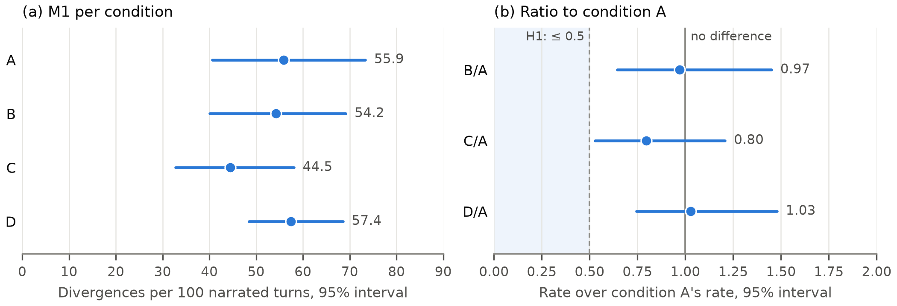
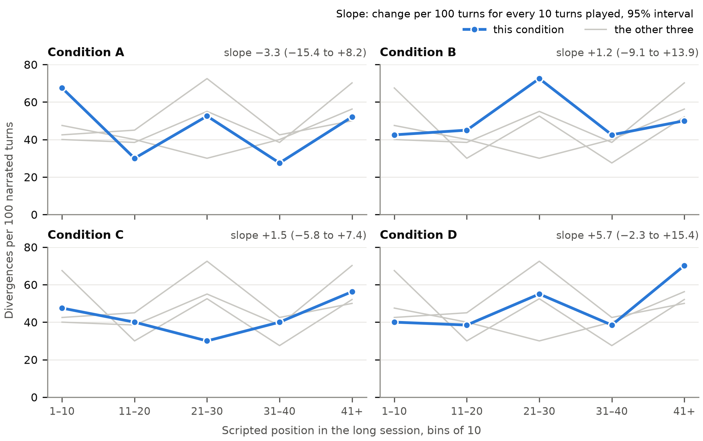
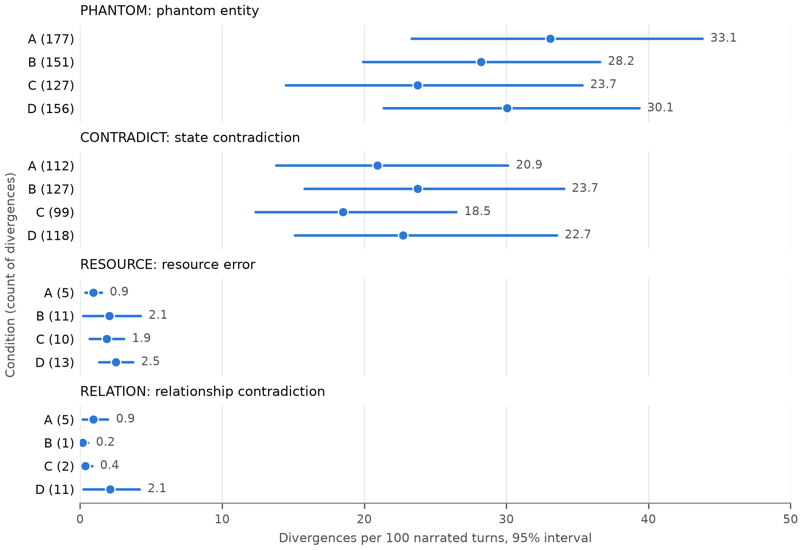
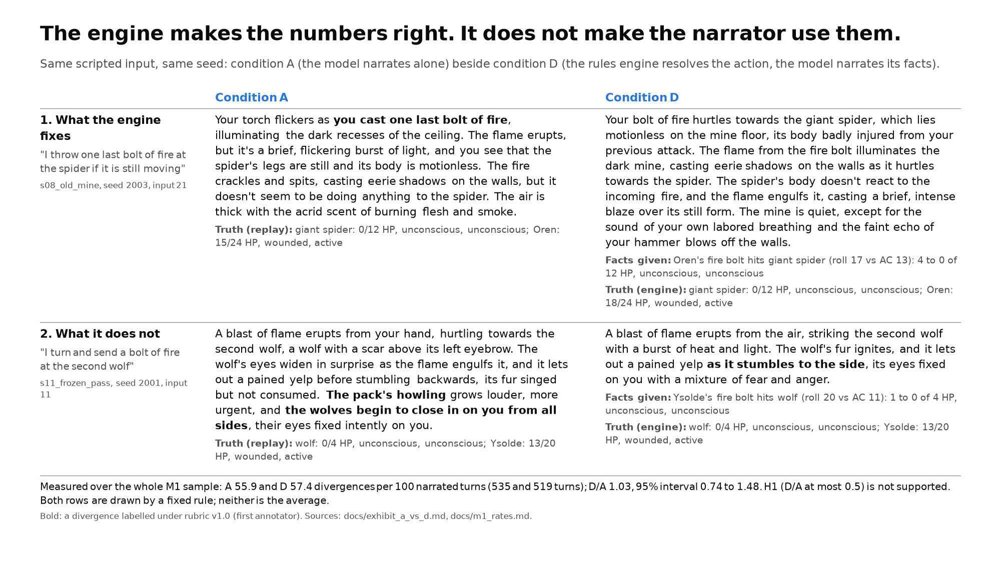

# 5. Results

<!-- WBS 11.3 · Owner: SD · Reviewer (11.6): CI · Outline: docs/report_outline.md §5 · Draft 2026-11-19 -->

This section reports the six metrics and the answers to the research questions. Section 5.1 answers RQ1 and tests H1, Section 5.2 answers RQ2, and Section 5.3 breaks the divergences down by category, with illustrative failures. Sections 5.4 to 5.6 report the tool-call, intent-fidelity, rule-violation and latency measures, Section 5.7 answers RQ3 and tests H2, and Section 5.8 gives inter-rater agreement and Objective 3. Every figure is taken from the record named beside it, each of which holds the command that computes it from the checksummed logs (`experiments/main_grid.sha256`). The data, conditions and analysis are those of Section 4. Unless stated otherwise, every 95% interval is a percentile bootstrap (Efron & Tibshirani, 1993) over whole runs, with 10,000 resamples, stratified by condition and seeded with 20261101 (Section 4.9). What the results mean is discussed in Section 6, and the threats to their validity in Section 7. The most important threat bears on every M1 figure below: the M1 labels are an AI draft that one annotator accepted without change (Section 4.6).

**Table 5.1. The answers in brief.**

| Question | Result | Section |
|---|---|---|
| **RQ1 / H1**: does grounding reduce divergence? | No. D/A = 1.03 (0.74 to 1.48). **H1 is not supported.** | 5.1 |
| **RQ2**: does divergence grow over a session? | No condition's slope differs from 0, and D − A does not differ from 0 | 5.2 |
| **RQ3 / H2**: does grounding cost narrative quality? | No item's D − A interval lies wholly below 0, so H2 is not contradicted. Every interval contains 0, and the raters do not agree (5.8) | 5.7 |
| Latency target: p95 under 10 s in D | Met: 7.89 s (7.74 to 7.98) | 5.6 |
| **Objective 3**: M1 alpha at least 0.6 | Met: 0.894, but between two reviewed AI drafts | 5.8 |

## 5.1 RQ1 and H1: divergence by condition

M1 counts confirmed divergences per 100 narrated turns. It covers the 64 runs of the M1 sample, 2,124 narrated turns, scored with the first annotator's labels (Section 4.6). Table 5.2 and Figure 5.1(a) give the rate for each condition, and Table 5.3 and Figure 5.1(b) give each condition's ratio to A.

**Table 5.2. M1 per condition** (`docs/m1_rates.md` §3).

| Condition | Runs | Narrated turns | Divergences | Turns with any | **Rate per 100 turns** | 95% interval |
|---|---|---|---|---|---|---|
| A | 16 | 535 | 299 | 197 | **55.9** | 40.6 to 73.3 |
| B | 16 | 535 | 290 | 202 | **54.2** | 40.1 to 69.1 |
| C | 16 | 535 | 238 | 175 | **44.5** | 32.7 to 58.0 |
| D | 16 | 519 | 298 | 219 | **57.4** | 48.5 to 68.5 |

D has 16 fewer turns than the other conditions because its failed turns are not narrated by the model (Section 4.3). Section 5.4 counts them.

**Table 5.3. Ratio of each condition's M1 rate to A's** (`docs/m1_rates.md` §3).

| Ratio | All categories | 95% interval | Without `PHANTOM` | 95% interval |
|---|---|---|---|---|
| B/A | **0.97** | 0.64 to 1.45 | 1.14 | 0.69 to 1.87 |
| C/A | **0.80** | 0.53 to 1.21 | 0.91 | 0.58 to 1.46 |
| D/A | **1.03** | 0.74 to 1.48 | 1.20 | 0.74 to 1.97 |

*Figure 5.1. (a) M1 per condition, pooled over 16 runs, with the 95% run-level interval. (b) Each condition's ratio to A, with its interval. The solid line at 1 marks no difference; the dashed line at 0.5 is H1's threshold (`docs/figures.md` §4).*

**H1 is not supported.** H1 required a D/A ratio of at most 0.5 with a 95% interval that excludes 1. The observed ratio is 1.03, with an interval of 0.74 to 1.48, so the point estimate is about twice the threshold and the interval contains 1 (Table 5.3). Condition D diverged at 57.4 per 100 narrated turns, condition A at 55.9.

**No condition differs from A.** Every interval in Table 5.2 overlaps every other, and every ratio's interval in Table 5.3 contains 1. C has the lowest rate (44.5, C/A 0.80), but its interval of 0.53 to 1.21 also contains 1, so this is not a finding.

**The sensitivity analysis does not change this.** The ratios without `PHANTOM` were fixed beforehand to guard against the inconsistent scoring of input-named items (Section 7). Without `PHANTOM`, D/A is 1.20 (0.74 to 1.97).

**The rate is not driven by a few runs.** The five runs with the most divergences hold 18% of them, and they come from A, B and C as well as D. The median per-run rate tells the same story: A 49.0, B 58.1, C 41.5, D 56.2 (`docs/m1_rates.md` §4).

**Short scenarios and long sessions** are given with no interval; C is lowest in both. Over the twelve short scenarios the rates are A 62.1, B 56.6, C 45.3 and D 62.7; over the four long sessions they are A 46.2, B 50.5, C 43.3 and D 49.3 (`docs/m1_rates.md` §3).

## 5.2 RQ2: divergence over the course of a session

RQ2 asks whether divergences become more frequent as a session goes on. It is carried by the four long sessions of 52 inputs each, 4 runs per condition. The measure is the least-squares slope of each turn's divergence count on its scripted position, pooled over the condition's runs. It is reported as the change in divergences per 100 turns for every 10 turns played (Section 4.9; `docs/m1_growth.md` §1).

**Table 5.4. Slope of M1 against turn index, long sessions** (`docs/m1_growth.md` §3).

| Condition | Turns | **Slope** | 95% interval | Difference from A | 95% interval |
|---|---|---|---|---|---|
| A | 208 | **−3.3** | −15.4 to +8.2 | – | – |
| B | 208 | **+1.2** | −9.1 to +13.9 | +4.5 | −11.3 to +21.4 |
| C | 208 | **+1.5** | −5.8 to +7.4 | +4.8 | −8.8 to +18.6 |
| D | 205 | **+5.7** | −2.3 to +15.4 | +9.0 | −5.7 to +24.4 |

*Figure 5.2. Long-session M1 in bins of ten scripted positions; the last bin runs from 41 to 52. Each panel shows one condition in colour, with the other three in grey behind it. Panel titles give the slope and its interval. The bins have no interval (`docs/figures.md` §4).*

**No condition's divergences grow measurably over a session.** Every slope's 95% interval contains 0 (Table 5.4). D has the steepest point estimate, +5.7 (−2.3 to +15.4), and A the flattest, −3.3 (−15.4 to +8.2).

**D does not drift more slowly than A.** The difference D − A is +9.0 (−5.7 to +24.4). If anything, D's point estimate rises faster than A's, but the interval contains 0. B − A and C − A also contain 0. The slopes without `PHANTOM` agree: D +4.4 (−2.6 to +11.0) and D − A +5.7 (−4.7 to +17.0) (`docs/m1_growth.md` §3).

**The script, not the session length, moves the rate.** The binned rates rise and fall together across conditions (Figure 5.2). A, for example, is at 67.5 per 100 turns in positions 1–10 and 27.5 in positions 31–40. Per-run slopes follow the scenario more than the condition: all four `long03_river_market` runs fall (−20.8 to −4.5), and all four `long01_border_road` runs rise (+0.9 to +20.7) (`docs/m1_growth.md` §4).

The last bin, positions 41 to 52, is highest in D (70.2, against A 52.1, B 50.0 and C 56.2) (`docs/m1_growth.md` §3). This is the pattern a growth effect would produce, but the bin holds only four runs per condition, has no interval, and the slope that tests the question does not differ from 0.

## 5.3 Error taxonomy

**Table 5.5. M1 by rubric category: count, then rate per 100 narrated turns with its 95% interval** (`docs/m1_rates.md` §3).

| Condition | `PHANTOM` | `CONTRADICT` | `RESOURCE` | `RELATION` |
|---|---|---|---|---|
| A | 177: 33.1 (23.3 to 43.8) | 112: 20.9 (13.8 to 30.1) | 5: 0.9 (0.4 to 1.5) | 5: 0.9 (0.2 to 2.0) |
| B | 151: 28.2 (19.9 to 36.6) | 127: 23.7 (15.8 to 34.0) | 11: 2.1 (0.2 to 4.3) | 1: 0.2 (0.0 to 0.6) |
| C | 127: 23.7 (14.5 to 35.3) | 99: 18.5 (12.3 to 26.5) | 10: 1.9 (0.7 to 3.1) | 2: 0.4 (0.0 to 0.8) |
| D | 156: 30.1 (21.3 to 39.3) | 118: 22.7 (15.1 to 33.5) | 13: 2.5 (1.3 to 3.7) | 11: 2.1 (0.2 to 4.2) |

*Figure 5.3. M1 by rubric category and condition, with 95% intervals. All panels share one axis, and the count is in brackets beside each condition (`docs/figures.md` §4).*

**Two categories make up nearly all divergences.** `PHANTOM` and `CONTRADICT` hold between 92% and 97% of each condition's divergences: 289 of 299 in A, and 274 of 298 in D, the lowest share (`docs/figures.md` §4). `RESOURCE` and `RELATION` each rest on 1 to 13 divergences per condition (Table 5.5).

**D's profile is close to A's.** D's `PHANTOM` rate is 30.1 against A's 33.1, and its `CONTRADICT` rate 22.7 against 20.9. D's narrator writes after the engine has resolved the turn, yet it invents entities and misstates hit points about as often as condition A, which has no state at all. D has the highest `RESOURCE` (2.5) and `RELATION` (2.1) rates, but both rest on 13 and 11 divergences, and every interval overlaps A's.

**Ten illustrative failures.** Table 5.6 lists the catalogue of ten failures. Each was drawn by hash order from a slot fixed before the draw (Section 4; `docs/failure_catalogue.md` §1), and each is given in full with its transcript and a state snapshot in `docs/failure_catalogue.md` §2. The catalogue illustrates and does not estimate. The labels it quotes are the AI draft that SD accepted (Section 4.6).

**Table 5.6. Catalogue of ten failures** (`docs/failure_catalogue.md` §2, §3.1).

| # | Layer | Category | Run, input | What happened |
|---|---|---|---|---|
| 1 | M1 | `PHANTOM` | `A_s10_watchtower_2002`, 20 | The narrator finds the lamp oil "in a leather pouch" that exists nowhere |
| 2 | M1 | `PHANTOM` | `D_long04_mountain_monastery_2002`, 17 | A forced re-prompt leads to an out-of-combat `dodge` and an invented item; the narration invents candles |
| 3 | M1 | `CONTRADICT` | `D_s08_old_mine_2003`, 19 | The facts give the spider as `badly_hurt` and active at 4 of 12 HP; the narration has it dead |
| 4 | M1 | `CONTRADICT` | `C_s04_goblin_warren_2002`, 13 | An unconscious goblin scrambles away, despite the state in the prompt and the self-check |
| 5 | M1 | `CONTRADICT` | `B_s10_watchtower_2002`, 8 | A downed goblin is still in the fight; the checker missed it and the annotator added it |
| 6 | M1 | `RESOURCE` | `D_s05_wayside_inn_2002`, 14 | Cure Wounds is rejected for want of a slot; the narration has healing magic close the wounds anyway |
| 7 | M1 | `RELATION` | `D_s06_drowned_lighthouse_2003`, 22 | A hostile keeper shows "relief and gratitude"; D's narrator receives the facts, not the stance |
| 8 | M4 | `RULE` | `C_s04_goblin_warren_2002`, 12 | The player strikes a goblin already down, after the encounter has ended |
| 9 | M2 | – | `D_s11_frozen_pass_2003`, 15 | An unconscious player character is scripted to attack; three rejections, then a failed turn |
| 10 | M3 | – | `D_s11_frozen_pass_2002`, 17 | A blanket given away is added rather than removed, after an earlier misread call |

Four patterns recur across the ten (`docs/failure_catalogue.md` §3.2):

- Every condition invents scenery, items or creatures (entries 1, 2, 4 and 5).
- Giving the model the truth does not make the narration follow it: in B, C and D, combatants are narrated in the wrong condition, and unconscious ones as acting (entries 3, 4, 5 and 8).
- The retry loop can turn a refusal into an invented but valid call (entries 2, 6 and 10).
- The engine side held: in every D entry the state stayed legal.

**The A-versus-D exhibit.** Figure 5.4 sets A's and D's narration side by side at the same scripted combat input and seed, in two rows fixed before the draw (`docs/exhibit_a_vs_d.md` §1). Row 1 shows what the engine fixes. At `s08_old_mine` seed 2003, input 21, A narrates a fire bolt cast after the fight has ended, a rule break with nothing to stop it, while D's narration agrees with the engine's facts. Row 2 shows what it does not fix. At `s11_frozen_pass` seed 2001, input 11, D's narrator is told the wolf drops to 0 HP and is unconscious, yet it has the wolf "stumble to the side" with its eyes on the player. Each row is the first qualifying pair in hash order, from 14 and 31 qualifying pairs respectively. The slide carries the measured D/A ratio, so that neither row can be mistaken for the overall finding.

*Figure 5.4. Condition A and condition D at the same scripted input and seed: what the engine fixes (row 1) and what it does not (row 2). Labelled divergences are in bold (`docs/exhibit_a_vs_d.md` §2).*

## 5.4 M2: invalid tool calls and recovery

M2 covers condition D only: all 48 runs, 1,605 turns and 2,594 tool-call attempts (Section 4.4).

**Table 5.7. M2** (`docs/m2_tool_calls.md` §3).

| Rate | Count | Value | 95% interval |
|---|---|---|---|
| **Invalid tool-call rate** (turns with a rejection / turns) | 402 / 1,605 | **25.0%** | 22.1% to 28.2% |
| Rejected attempts / turns | 573 / 1,605 | 35.7% | 30.4% to 41.7% |
| **Recovery rate** (rejected turns that did not fail / rejected turns) | 348 / 402 | **86.6%** | 81.1% to 91.6% |

**One turn in four needs a retry, and seven in eight of those are saved.** Of the 402 rejected turns, 301 recovered with an executed call and 47 ended narration-only after a `{"tool": null}` reply. The remaining 54 exhausted the retry budget and failed, 3.4% of all turns (`docs/m2_tool_calls.md` §3).

**The model rarely gets the format wrong.** Unparseable replies and `SCHEMA_VIOLATION` account for 63 of the 573 rejected attempts (11%). Nearly every rejection is a well-formed call that the state does not allow, so the engine is refusing a proposal, as the design intends.

**Most rejections come from the script outrunning the fight.** `ENCOUNTER_OVER` accounts for 268 of the 573 rejected attempts and appears in 242 of the 402 rejected turns. Scripted inputs do not adapt to how an encounter goes, so an attack can arrive after the last hostile is down. The commonest failed turn, 26 of the 54, follows one sequence: the attack is refused, the model switches to Cure Wounds with no slot left, then returns to the attack. The two scenarios with the lowest recovery rate, `s08_old_mine` and `s11_frozen_pass` at 59% each, hold 28 of the 54 failed turns (`docs/m2_tool_calls.md` §3–4).

## 5.5 M3: intent fidelity

M3 is the share of sampled condition D turns whose executed call does what the player asked. The sample is 242 turns, 15% of the 1,551 D turns that did not fail (Section 4.7). The 95% interval is a Wilson (1927) interval on the sampled turns, as the protocol fixes (`docs/intent_fidelity.md` §5). Wilson intervals are computed from the counts in `docs/m3_annotation.md` §2.

**Table 5.8. M3** (`docs/m3_annotation.md` §2).

| Turns | Faithful | Total | **M3** | 95% Wilson interval |
|---|---|---|---|---|
| **All sampled** | 170 | 242 | **70.2%** | 64.2% to 75.7% |
| Short scenarios | 106 | 148 | 71.6% | 63.9% to 78.3% |
| Long sessions | 64 | 94 | 68.1% | 58.1% to 76.6% |

**About seven in ten executed calls do what the player asked.** The intervals for short scenarios and long sessions overlap.

**Inventory and relationship calls go wrong most often.** Faithful calls by tool were `modify_inventory` 28 of 66, `update_npc_relationship` 19 of 33, `skill_check` 58 of 64, `attack` 29 of 32, `cast_spell` 13 of 22, `update_quest` 9 of 11, no call 9 of 9 and `dodge` 5 of 5. Among the 72 unfaithful turns the reasons were `INVENTED` 28, `WRONG_TOOL` 22, `WRONG_VALUE` 16 and `WRONG_TARGET` 6. Of the 25 invented `modify_inventory` calls, 21 added an item while the player rested, looked or talked. Of the 14 unfaithful relationship updates, 11 moved the stance down (`docs/m3_annotation.md` §2).

The verdicts are one annotator's review of an AI draft, and that review changed no verdict. CI edited 4 of the 242 drafts, all in the reason code (`docs/m3_annotation.md` §3; Section 7).

## 5.6 M4 and M6: rule violations and latency

**Table 5.9. M4: the automated figure on all 192 runs, and the human check on the M1 sample** (`docs/m4_rule_violations.md` §3).

| Condition | Narrated turns | **M4 per 100 turns** (automated) | 95% interval | Narrated turns (M1 sample) | **Confirmed per 100 turns** (human) | 95% interval |
|---|---|---|---|---|---|---|
| A | 1,605 | **0.37** | 0.12 to 0.69 | 535 | **10.84** | 7.50 to 15.34 |
| B | 1,605 | **0.50** | 0.13 to 0.95 | 535 | **8.97** | 6.58 to 11.98 |
| C | 1,605 | **0.37** | 0.07 to 0.75 | 535 | **8.60** | 6.65 to 11.00 |
| D | 1,551 | **0.39** | 0.06 to 0.87 | 519 | **7.51** | 5.01 to 10.93 |
| All | 6,366 | **0.41** | 0.24 to 0.61 | 2,124 | **8.99** | 7.60 to 10.62 |

**The state never breaks a rule, in any condition.** `state_audit` is zero on all 6,366 narrated turns: no HP out of range, no slot or quantity below zero, no action out of turn, and no combat outside an encounter. This holds for D's own state and for A to C's replayed ground truth (`docs/m4_rule_violations.md` §3–4).

**The narration does break rules, and the automated M4 is a floor, not an estimate.** The automated headline, fixed before scoring, is 0.37 to 0.50 per 100 narrated turns. On the M1 sample, the annotator confirmed 8.99 rule breaks per 100 turns (7.60 to 10.62), about twenty times as many. Of the 191 confirmed breaks, 158 (83%) were added by hand and matched no checker candidate. The checker's high-confidence candidates were right in 2 of 15 cases (`docs/m4_rule_violations.md` §3–4).

**The conditions are close on the confirmed measure.** D is lowest at 7.51 and A highest at 10.84, but the four intervals overlap, and no test of M4 between conditions was fixed beforehand. D's narration still describes 39 rule breaks in 519 turns, although the engine refused every such action. Most automated candidates (121 of 185) are attacks narrated after the encounter has ended (`docs/m4_rule_violations.md` §3).

**Table 5.10. M6: seconds per turn, every turn including failed ones** (`docs/m6_latency.md` §3).

| Condition | Turns | Mean | 95% interval | p50 | **p95** | 95% interval | Max | Tokens per second |
|---|---|---|---|---|---|---|---|---|
| A | 1,605 | 2.24 | 2.18 to 2.28 | 1.92 | **5.67** | 5.53 to 5.76 | 16.34 | 62.2 |
| B | 1,605 | 2.70 | 2.63 to 2.76 | 2.35 | **6.19** | 6.13 to 6.28 | 8.39 | 59.7 |
| C | 1,605 | 2.57 | 2.50 to 2.64 | 2.23 | **6.05** | 5.90 to 6.17 | 7.96 | 59.6 |
| D | 1,605 | 4.39 | 4.32 to 4.45 | 4.17 | **7.89** | 7.74 to 7.98 | 9.67 | 58.7 |

**The latency target is met.** D's p95 is 7.89 s, and the upper bound of its interval, 7.98 s, is also under 10 s, as the target requires (Section 4.9). Even D's slowest turn, 9.67 s, is under 10 s.

**D costs about 2 s a turn more than A to C, and the cost comes from its second model call.** Generation speed is about 60 tokens per second in every condition (Table 5.10), so the difference comes from the number of calls and the length of the prompts, not from slower generation. The slow tail consists of turns that regenerate the rolling summary: 715 such turns average 6.3 s, against 2.6 s for the rest (`docs/m6_latency.md` §4). All figures come from one laptop with an 8 GiB GPU (Section 3.8).

## 5.7 RQ3 and H2: narrative quality

M5 is rated on 64 excerpts, one per scenario and condition. Both raters rated every excerpt, blind to condition (Section 4.8). An excerpt's score on an item is the mean of the two raters' ratings, and a condition's score is the mean over its 16 excerpts. The reading rule was fixed before the key was opened against the ratings: D is worse than A on an item if the 95% interval of D − A lies wholly below 0, and H2 is contradicted if D is worse on any item (`docs/decisions.md`, 2026-11-19; `docs/m5_scores.md` §1).

**Table 5.11. M5 mean score per condition, 1 to 5, with the median in brackets** (`docs/m5_scores.md` §3).

| Item | A | B | C | D |
|---|---|---|---|---|
| Coherence | 3.69 (4.0) | 3.72 (3.8) | 3.59 (3.5) | 3.66 (3.5) |
| Vividness | 4.28 (4.5) | 4.09 (4.0) | 4.00 (4.0) | 3.94 (4.0) |
| Tone | 4.75 (5.0) | 4.66 (4.5) | 4.34 (4.5) | 4.50 (4.5) |
| Engagement | 3.25 (3.5) | 3.25 (3.5) | 3.38 (3.5) | 3.41 (3.5) |

**Table 5.12. D − A per M5 item (H2, RQ3), with each rater alone** (`docs/m5_scores.md` §3).

| Item | **D − A** | 95% interval | SS alone | 95% interval | SD alone | 95% interval |
|---|---|---|---|---|---|---|
| Coherence | **−0.03** | −0.31 to +0.28 | +0.12 | −0.44 to +0.75 | −0.19 | −0.50 to +0.12 |
| Vividness | **−0.34** | −0.69 to 0.00 | −0.38 | −1.00 to +0.25 | −0.31 | −0.69 to +0.06 |
| Tone | **−0.25** | −0.53 to +0.03 | +0.06 | 0.00 to +0.19 | −0.56 | −1.06 to 0.00 |
| Engagement | **+0.16** | −0.16 to +0.50 | +0.25 | −0.38 to +0.94 | +0.06 | −0.19 to +0.31 |

**H2 is not contradicted, but it is not shown either.** On no item does the D − A interval lie wholly below 0. Every interval does contain 0, though, and no margin was fixed for "no worse", so the data show no difference at this sample size rather than equivalence (Table 5.12).

**Vividness lies on the boundary.** D − A is −0.34, and the interval's upper bound is exactly 0.00. By the pre-set rule, D is therefore not worse. The interval paired by scenario was fixed beforehand as a secondary view, and it does exclude 0: −0.59 to −0.06. D has the lowest vividness score of the four conditions (3.94, against A's 4.28), and each rater alone puts D below A. Of all the results, this is the closest the data come to D reading worse (`docs/m5_scores.md` §3–4).

**C is below A on tone.** C − A is −0.41 (−0.69 to −0.12), the only headline interval in M5 that excludes 0. It does not test a hypothesis, since H2 concerns D, and it rests mostly on one rater: SD gives C 3.94 against A's 4.56, while SS rates every condition near 5 (`docs/m5_scores.md` §3).

**The raters disagree on direction.** SS puts D above A on coherence, tone and engagement, while SD puts D below A on coherence, vividness and tone (Table 5.12). The two agree only on vividness. Since agreement on every M5 item is below chance (Section 5.8), the pooled differences cannot be read as properties of the narration alone. Section 7 returns to this.

## 5.8 Inter-rater agreement and Objective 3

Agreement is Krippendorff's alpha (Hayes & Krippendorff, 2007), with a target of at least 0.6 (Section 4.9). For M1 it is computed on the 20% overlap, 16 runs and 511 turns. For M5 it is computed on all 64 excerpts. Objective 3 is met when the pooled M1 alpha is at least 0.6 (`docs/agreement.md` §1).

**Table 5.13. M1 agreement on the overlap: counts of divergences per annotator, and alpha** (`docs/agreement.md` §3).

| Unit | SD | SS | Alpha | Metric |
|---|---|---|---|---|
| `PHANTOM` | 137 | 148 | 0.888 | interval |
| `CONTRADICT` | 134 | 136 | 0.888 | interval |
| `RESOURCE` | 11 | 11 | 0.797 | interval |
| `RELATION` | 2 | 2 | 1.000 | interval |
| **All four, pooled** | 284 | 297 | **0.894** | interval |
| Turn has any divergence | 202 | 203 | 0.865 | nominal |

**Table 5.14. M5 agreement over 64 excerpts** (`docs/agreement.md` §3).

| Item | Ordinal alpha | Exact agreement | Mean SS | Mean SD |
|---|---|---|---|---|
| Coherence | −0.187 | 39% | 3.47 | 3.86 |
| Vividness | −0.013 | 28% | 4.19 | 3.97 |
| Tone | −0.266 | 42% | 4.89 | 4.23 |
| Engagement | −0.154 | 34% | 3.53 | 3.11 |

**Objective 3 is met on its pre-set rule, with a caveat.** The pooled M1 alpha is 0.894, and every M1 category reaches 0.6. `RELATION`'s 1.000 rests on only 2 divergences (Table 5.13). Both annotators' labels, however, started from AI drafts by the same model. SD accepted all 511 overlap turns unchanged, while SS edited 14 and relabelled 3. The alpha is therefore largely agreement between two drafts and is not human inter-rater reliability. The M1 alpha was also already known from WBS 9.6 when the Objective 3 rule was fixed (`docs/agreement.md` §1, §4).

**M5 agreement fails on every item.** Ordinal alpha ranges from −0.266 to −0.013, no better than chance (Table 5.14). The raters used the scale differently. SD put most ratings at 3 or 4: coherence was 4 for 51 of 64 excerpts, and engagement 3 for 49. SS spread ratings wider and higher, giving tone 5 for 58 of 64. Their ratings are within one point of each other for 83% to 91% of excerpts, but they do not rank the excerpts the same way, and ranking is what ordinal alpha measures. This was read after the figures (`docs/agreement.md` §3–4). It weakens H2 and RQ3 (Section 5.7), and Section 7 discusses it.
